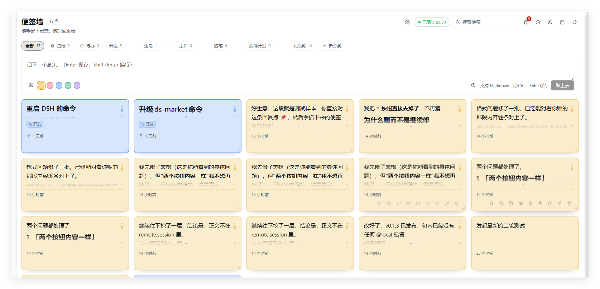
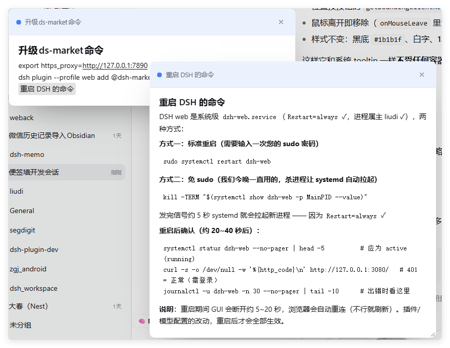
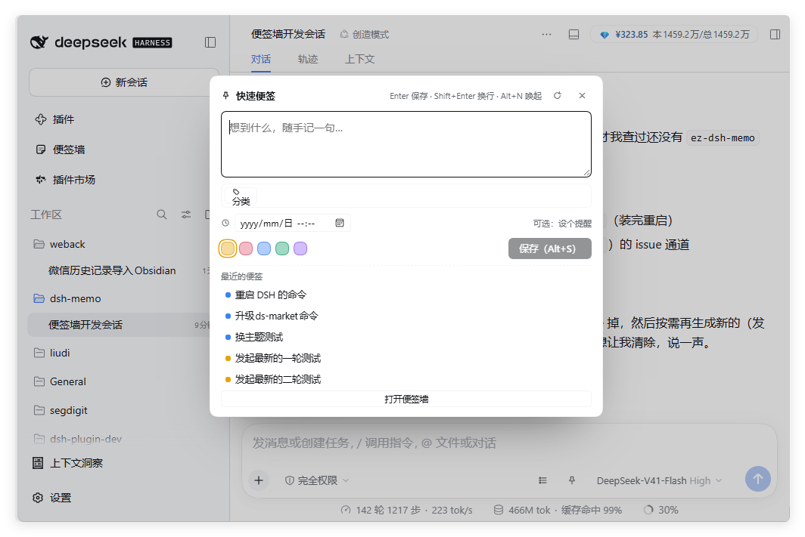
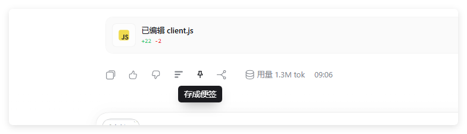

# ez-dsh-memo

DeepSeek Harness 的**便签墙**插件：随手记灵感、分类整理、设提醒、便签之间双向链接，还能把聊天内容一键收进便签。

中文 · [English](README.en.md)



## 安装

```bash
# 从 npm（推荐）
dsh plugin --profile web add ez-dsh-memo

# 或从 GitHub Release
dsh plugin --profile web add https://github.com/liudiw/ez-dsh-memo/releases/latest/download/ez-dsh-memo.tgz
```

装完**重启 harness**。要求 Node.js ≥ 20、DSH 具备标准客户端插槽（`main` / `sidebar.panellist` / `shell.overlay` / `conversation.input.right` / `settings.section`）。

> 每台运行 harness 的机器（含桌面版）都要单独装一次；便签数据默认各机独立，需要共享就配 fast-note-sync 同步。

## 核心能力

### 便签墙

- **错落排布 + 密集装箱**：默认每行 5 张，宽度自适应；空白处会被自动填满
- **拖拽调尺寸**：拖右下角改宽高，松手后整墙重新排布
- **拖拽排序**：按住便签拖动，其他便签用 FLIP 动画让位
- **就地编辑**：双击便签进入编辑，`Ctrl/Cmd+Enter` 保存
- **搜索高亮**：关键词命中处标黄，可与分类、筛选条件叠加

### 分类

- **多对多**：一张便签可属于多个分类
- 顶部分类栏显示每类计数，点击筛选；`Alt+C` 或「分类」按钮打开选择面板（**↑↓ 移动、空格勾选、回车确认**）
- 分类可拖拽排序、重命名、删除（删除只解除关联，不删便签）

### 提醒

- 每张便签可设**提醒时间 + 重复规则**（每天/每周/每月）
- 宿主每 15 秒扫描一次，到点弹出**不自动消失**的提醒卡（完成 / 延后 5 分钟 / 关闭）
- 支持 webhook 推送（企业微信、ntfy、PushDeer 等）与每日回顾摘要
- 逾期未完成的便签在墙上显示醒目标记

### 便签之间的双向链接 `[[...]]`

便签正文里可以写 `[[另一张便签]]`，点击即可跳到那张便签。

- **编辑时输入 `[[`** 会弹出便签候选列表：`↑↓` 选择、`Enter` 插入、`Esc` 取消
- 支持别名写法 `[[目标便签|显示文字]]`
- 插入后渲染成**可点链接**，点开是**新的悬浮查看卡**（不覆盖当前这张），可以顺着链接一路看下去
- 链接目标不存在时显示为普通文字，不会报错
- 快速便签、查看卡、便签编辑态里都能用

> 如果你打着 `[[` 没看到候选，请确认是在**便签的编辑态**里（查看卡 → 编辑，或便签卡双击），而不是聊天输入框。

### 查看卡



- 独立悬浮窗，可**拖动**、可**拖右下角缩放**，正文随宽度自动重排
- 卡内可以直接编辑、设提醒、加分类、导出图片
- 卡里的 `[[链接]]` 点击后**另开一张卡**，多张卡可同时存在

### 快速便签



- 全局快捷键 **`Alt+N`**，或点会话输入框旁的 📌
- `Enter` 保存、`Shift+Enter` 换行、**`Alt+S` 保存**、**`Alt+R` 重置**
- 可选颜色、分类（多选）、提醒时间
- **草稿自动保存**：正文/颜色/分类/提醒一起存到本地，关窗口、刷新、重启后都能接着写
- 关闭时若有内容，会问「存草稿 / 不存，清空 / 取消」
- 保存后窗口自动关闭，光标回到会话输入框末尾

### 便签抽屉

- **`Alt+M`** 或点会话输入框旁的列表按钮，从右侧滑出
- 可搜索，`↑↓` 选择、`Enter` 打开
- 点任意一条 → **在会话里浮出查看卡**，不打断聊天；点抽屉外面的空白关闭抽屉（卡片保留）

### 把聊天内容收进便签



- 每条助手回复的操作条上有 **📌 存成便签**：点一下把这条回复收进便签
- 收集时**还原 Markdown**：标题、列表（含嵌套）、代码块（保留语言与缩进）、表格（自动补分隔行）、引用、链接、粗体斜体
- 只取正文，**不会把「已编辑 client.js / 用量 1.3M tok」这类状态条混进来**
- 也可以选中任意文字，用选区右下的气泡「存为便签」

### 其它

- **回收站**：删除进回收站保留 7 天，可还原或彻底清空
- **归档**：归档后不在墙上显示，但可搜索到
- **撤销**：`Ctrl/Cmd+Z` 撤销编辑、移动、归档、删除（最近 20 步）
- **图片**：粘贴或上传，按内容寻址存本地，同步时上传到 vault 的 `attachments/<日期>/`
- **任务清单**：`- [ ]` 渲染成可点的复选框
- **导出图片**：把一张便签画成纸感 PNG 下载
- **AI 读写**：内置 `memo` 工具（`list` / `add` / `update` / `remove` / `get` / `sync`），模型可以直接操作这面墙

## 同步到 fast-note-sync（可选）

便签**始终**保存在本机 `~/.dsh/dsh-memo/notes.json`，同步只是把它镜像成 Markdown。

在 **设置 → 便签墙** 里填：服务地址、访问令牌、Vault 名称、便签目录（默认 `便签墙`）、附件目录（默认 `attachments`）、同步间隔。

- 令牌只显示尾号，**不会明文回显**；留空表示不修改
- 图片上传到 vault 的 `attachments/<YYYY-MM-DD>/<hash>.<ext>`
- 前端带 `dsh-memo-*` frontmatter 记录颜色/置顶/提醒等元数据

## 快捷键

| 按键 | 作用 |
| --- | --- |
| `Alt+N` | 快速便签（开/关） |
| `Alt+S` | 保存快速便签并关闭 |
| `Alt+R` | 重置快速便签 |
| `Alt+C` | 分类选择面板（↑↓ / 空格 / 回车） |
| `Alt+M` | 便签抽屉（开/关） |
| `Alt+W` | 关闭最上层浮窗 |
| `Ctrl/Cmd+Z` | 撤销 |
| `Ctrl/Cmd+Enter` | 保存编辑 |

## 数据位置

```
~/.dsh/dsh-memo/
├── notes.json     便签本体（原子写，0600）
├── images/        图片缓存（内容寻址）
├── sync.json      同步配置（0600，令牌不回显）
├── remind.json    推送通道 / 每日回顾（可选）
└── pwa.json       可选：存在时注入 PWA manifest
```

## 与同类插件对比

| | ez-dsh-memo | dsh-sticky-note | dsh-sticky-notes |
| --- | --- | --- | --- |
| 形态 | **独立墙面** | 输入框旁浮层 | 可拖拽便签纸 |
| 排版 | 密集装箱 + 拖拽调尺寸/排序 | 列表/堆叠 | 自由拖动 |
| 分类 | **多对多 + 拖拽排序** | 固定三类 | — |
| 提醒 | **时间 + 重复 + 推送 + 每日回顾** | — | — |
| 便签互链 | **`[[双向链接]]`** | — | — |
| 聊天收集 | **单条回复 → 便签（Markdown 还原）** | — | — |
| Markdown 同步 | **fast-note-sync（vault + 附件）** | 归档目录 | — |
| 回收站/归档/撤销 | **都有** | 归档 + 自动清理 | — |
| AI 读写 | **`memo` 工具** | 发送到对话 | 读写 |

## 开发

```bash
node --check index.js && node --check client.js && node --check sync.js
./scripts/release.sh 0.1.7   # 在临时目录改名打包，不动工作区的 @local 包名
```

工作区安装名固定为 `@local/dsh-memo`（本机软链），发布包名 `ez-dsh-memo`。

## 许可

MIT
